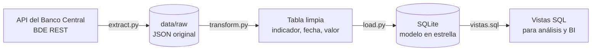
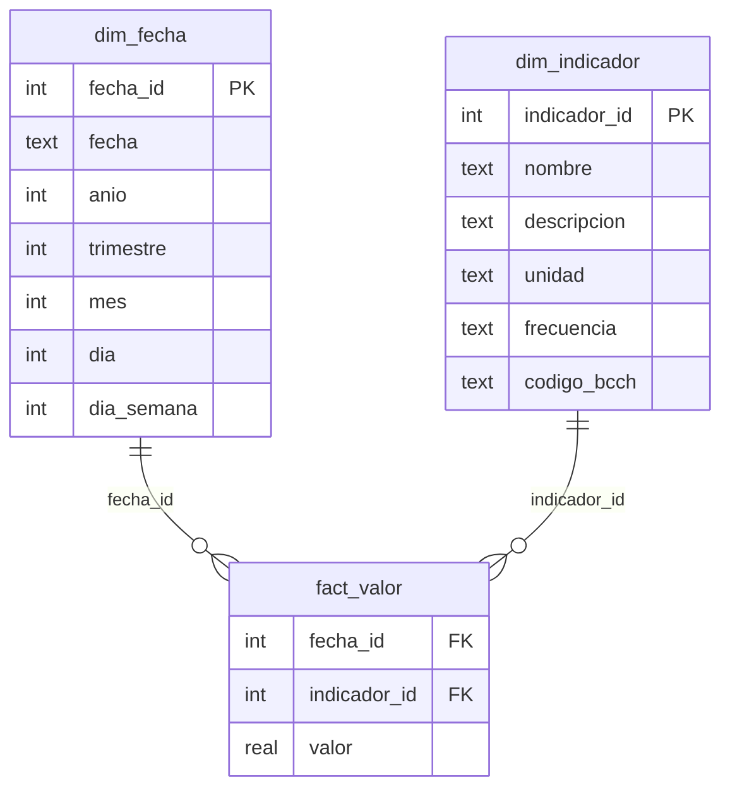

# ETL de indicadores económicos de Chile

[](https://github.com/Ketrafe/etl-indicadores-chile/actions/workflows/pipeline.yml)

Pipeline en **Python y SQL** que descarga indicadores económicos desde la API oficial del Banco Central de Chile, los limpia, los carga a una base **SQLite con modelo en estrella** y valida su consistencia con consultas SQL.

> **Resultado clave:** el IPC mensual calculado en SQL a partir del índice coincide con la serie oficial del Banco Central en los **81 meses** comparados (diferencia máxima: 0,0 puntos porcentuales).

## Arquitectura



## Fuente de datos

[Base de Datos Estadísticos (BDE) del Banco Central de Chile](https://si3.bcentral.cl/estadisticas/Principal1/Web_Services/documentacion.html), consultada por API REST con un token gratuito. Se descargan datos desde el 1 de enero de 2020.

| Indicador | Código BCCh | Frecuencia |
|---|---|---|
| Dólar observado (CLP por USD) | `F073.TCO.PRE.Z.D` | Diaria |
| Unidad de fomento (UF) | `F073.UFF.PRE.Z.D` | Diaria |
| Unidad tributaria mensual (UTM) | `F073.UTR.PRE.Z.M` | Mensual |
| IPC general, índice base 2023=100 | `G073.IPC.IND.2023.M` | Mensual |
| IPC general, variación mensual oficial | `G073.IPC.VAR.2023.M` | Mensual |

## Modelo de datos

Modelo en estrella: una tabla de hechos con los valores y dos dimensiones que los describen. Carga actual: 4.479 valores en 2.515 fechas.



Las vistas de `sql/vistas.sql` exponen los datos ya unidos (`v_indicadores`), las variaciones mensuales (`v_variacion_mensual`, con función de ventana `LAG`) y la validación del IPC (`v_ipc_validacion`).

## Decisiones de diseño

1. **Fuente oficial en vez de una API comunitaria.** Mi primera opción dejó de estar disponible durante el desarrollo, así que migré a la API del Banco Central.
2. **IPC con base 2023.** La serie con base 2018 termina en diciembre de 2023; la de base 2023 llega hasta la fecha.
3. **Días sin dato descartados.** El dólar observado no se publica en fines de semana ni feriados: la API los devuelve como `ND` y se eliminan en la limpieza (797 filas).
4. **Capa raw.** La respuesta original se guarda en `data/raw/`, así se puede reprocesar sin volver a llamar a la API.
5. **Carga completa e idempotente.** Ejecutar el pipeline dos veces deja exactamente el mismo resultado, y la carga ocurre en una sola transacción.
6. **Secretos fuera del código.** El token vive en un archivo `.env` excluido de Git, y los errores se reportan sin mostrar la URL, que lo contiene.
7. **Validación cruzada.** La variación mensual del IPC se calcula en SQL desde el índice y se compara con la serie oficial.

## Calidad

- Control de calidad en la transformación: rechaza nulos, fechas duplicadas y valores no positivos.
- 15 pruebas automáticas con `pytest`, ejecutadas en cada `push` mediante integración continua.
- Registro de eventos por etapa y código de salida distinto de cero si algo falla.
- Cada ejecución y cada error quedan guardados en tablas de control (sección siguiente).

## Automatización

Un workflow de GitHub Actions (`.github/workflows/pipeline.yml`) ejecuta:

- **En cada `push`:** las pruebas.
- **Cada lunes y bajo demanda:** pruebas, pipeline completo, un resumen de resultados en la propia ejecución y la base `indicadores.db` como artefacto descargable.

El token del Banco Central se guarda como secreto del repositorio (`BCCH_TOKEN`) y nunca aparece en el código ni en los registros.

## Control y trazabilidad

Además del modelo en estrella, la base guarda tres tablas de control (`sql/schema_control.sql`) que se conservan entre ejecuciones:

| Tabla | Contenido |
|---|---|
| `meta_ejecucion` | Una fila por corrida: inicio, duración, estado (`EXITO`, `ERROR`, `INTERRUMPIDA`), filas cargadas y origen (local o GitHub Actions) |
| `meta_serie` | Una fila por serie: última fecha cargada, cantidad de filas y ejecución que la actualizó |
| `log_errores` | Cada error con su ejecución, etapa (extracción, transformación y carga, vistas), serie afectada y mensaje |

Decisiones de diseño:

- Los errores se escriben en una transacción propia: si la carga falla y se revierte, el registro del error se conserva.
- Antes de guardar un mensaje se eliminan los secretos (token y parámetros de la URL).
- Una ejecución que queda `EN_CURSO` y no termina se marca como `INTERRUMPIDA` en la corrida siguiente.
- Las horas se guardan en UTC.

Para ver el estado: `python src/control.py` muestra las últimas ejecuciones, los últimos errores y el estado de cada serie. En GitHub Actions cada corrida parte de una base nueva, por lo que allí las tablas reflejan solo la ejecución actual.

## Resultado de ejemplo

Dólar observado por año (CLP por USD; datos hasta el 19-11-2026):

| Año | Promedio | Mínimo | Máximo |
|---|---|---|---|
| 2020 | 792,2 | 710,3 | 867,8 |
| 2021 | 759,3 | 693,7 | 868,8 |
| 2022 | 872,3 | 777,1 | 1.043,0 |
| 2023 | 839,1 | 781,5 | 945,6 |
| 2024 | 943,6 | 877,1 | 996,4 |
| 2025 | 951,6 | 904,5 | 1.012,8 |
| 2026 (hasta nov.) | 918,3 | 854,3 | 1.002,1 |

## Cómo ejecutarlo

Necesitas un token gratuito de la API del Banco Central (registro en el sitio de la BDE).

```bash
git clone https://github.com/Ketrafe/etl-indicadores-chile.git
cd etl-indicadores-chile
python -m pip install -r requirements.txt
cp .env.example .env          # en Windows: copy .env.example .env
# edita .env y pega tu token en BCCH_TOKEN
python src/main.py            # pipeline completo
python src/analisis.py        # resultados de las vistas SQL
python -m pip install -r requirements-dev.txt
python -m pytest              # pruebas
```

## Estructura

```
src/           extract, transform, load, analisis, control, main y config
sql/           schema.sql (modelo), schema_control.sql (control) y vistas.sql
tests/         pruebas con pytest
exploracion/   scripts usados para descubrir la API y sus series
.github/       workflow de GitHub Actions
```

## Próximos pasos

- Dashboard en Power BI conectado a la vista `v_indicadores`.
- Carga incremental: hoy cada ejecución recarga todo el histórico; `meta_serie.ultima_fecha` permite pedir a la API solo los datos nuevos.
- Conservar la base entre ejecuciones de GitHub Actions para acumular el historial de control en la nube.

## Autor

Kevin Labra · [LinkedIn](https://linkedin.com/in/klabras) · [GitHub](https://github.com/Ketrafe)
